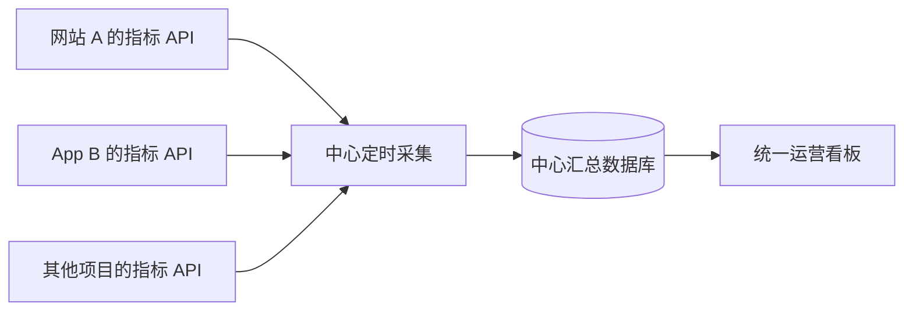
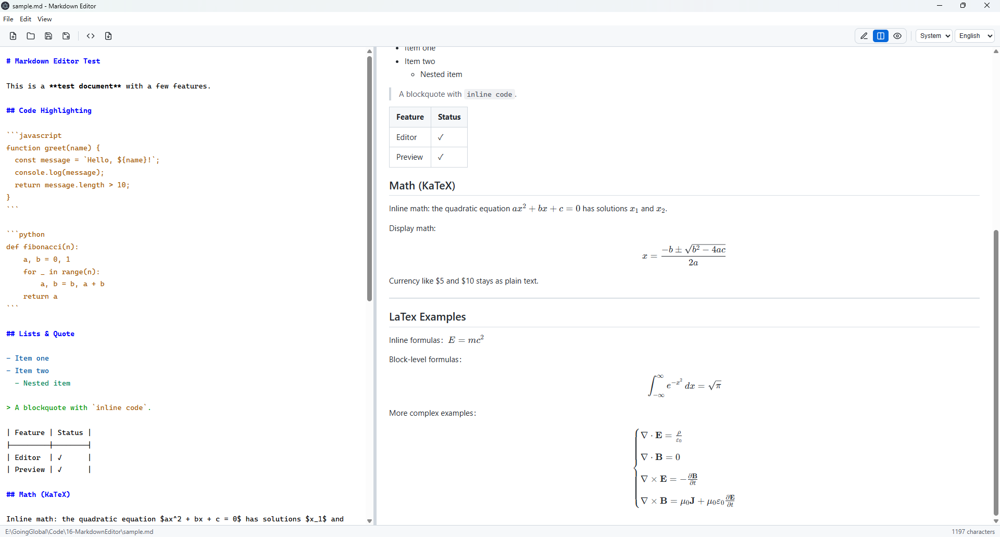
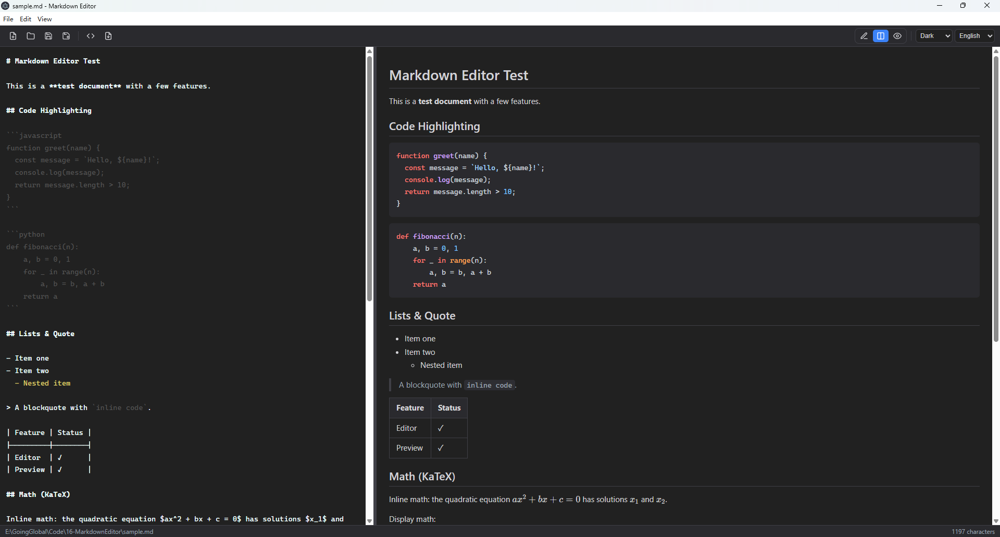
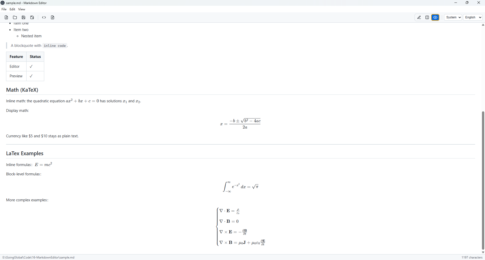
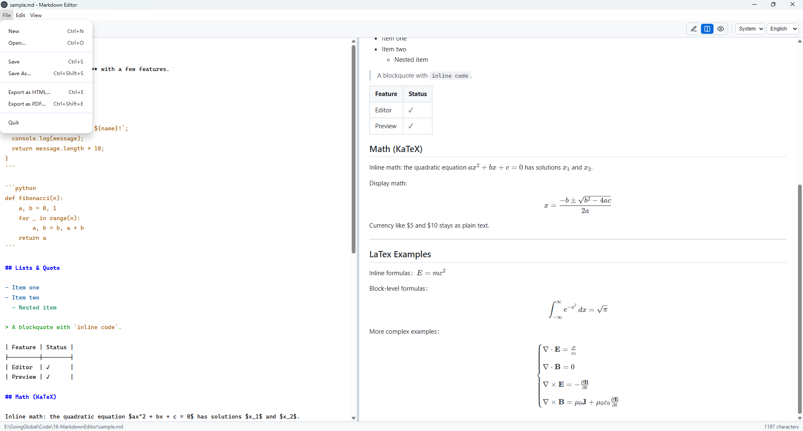

# Markdown Editor

A clean, cross-platform (Windows / macOS) Markdown editor built on Electron.

[See preview examples](#preview-examples) to try Markdown formatting, KaTeX, Bash and JavaScript highlighting, and Mermaid diagrams.

## Requirements Prompt

> Develop a Markdown editor that works on both Windows and Mac, supporting Markdown content editing, Markdown preview, and file open/save functions. Double-clicking a .md file in the system should open it directly in this app. The interface should be clean and simple.
>
> Enhancements needed: replace the textarea with CodeMirror for syntax highlighting, add code block highlighting (highlight.js), and support exporting to HTML/PDF. Toolbar buttons should use intuitive icons. Add internationalization support — the app defaults to English and can be switched to Chinese, Japanese, French, Korean, or German. Support System/Dark/Light mode switching.

## Features

- CodeMirror editor: Markdown syntax highlighting, automatic list continuation, Tab indentation
- Find and replace with match counts, case/whole-word/regex options, and Replace All
- Markdown formatting bar for emphasis, headings, quotes, code, links (`Ctrl/Cmd+K`), and lists
- Live preview with code block highlighting via highlight.js (Edit / Split / Preview-only views, switch with Ctrl+1/2/3)
- Safe preview that blocks executable raw HTML and unsafe URLs; external links open in the system browser
- Document outline with heading navigation
- New file (Ctrl+N), Open (Ctrl+O), Save (Ctrl+S), Save As (Ctrl+Shift+S)
- Multi-tab editing, recent files, and startup recovery of tabs and unsaved drafts
- Tab shortcuts for opening (`Ctrl/Cmd+T`), closing (`Ctrl/Cmd+W`), reopening (`Ctrl/Cmd+Shift+T`), and cycling (`Ctrl+Tab` and `Ctrl+Shift+Tab`)
- Paste screenshots or drop images to store them beside the document and insert relative paths
- Optional auto save and up to 20 local versions retained before file overwrites
- Atomic saves that safely replace files only after a complete write and report failures without damaging the original
- Preservation of UTF-8/UTF-16 encoding, BOM, and CRLF/LF line endings
- Export to HTML (Ctrl+E) / Export to PDF (Ctrl+Shift+E), exported content includes code highlighting styles
- Icon toolbar + detailed status bar (words, characters, lines, cursor position, and selection)
- Internationalization: defaults to English, switchable to 简体中文 / 繁體中文 / 日本語 / Français / 한국어 / Deutsch / Español / Português (Brasil) / Русский / Italiano (menus, dialogs, and UI all follow the selected language, with the choice persisted)
- Themes: System (follows OS) / Light / Dark, with coordinated colors for the editor and preview
- Double-click .md / .markdown files in the system to open directly in this app (installer build only)
- Unsaved changes protection on quit plus crash recovery for drafts
- External file change detection with a choice to load disk content or keep local edits
- Side-by-side external-change diffs; deleted or moved files can be located, saved elsewhere, closed, or kept open
- Editor settings for line numbers, wrapping, tab size, font size, default view, and auto save
- Go to Line (Ctrl/Cmd+L)
- Single-instance mode: double-clicking a file again reuses the already-open window

## Preview examples

### Mermaid flowchart



### Bash with embedded JavaScript

```bash
node - <<'JS'
const counts = { website: 1240, app: 870 };
const total = counts.website + counts.app;
console.log(`TOTAL_SESSIONS=${total}`);
JS
printf '%s\n' '已汇总'
```

### Math formulas

Use $r = \frac{s}{n}$ inline or put a formula in its own block.

$$
\bar{x} = \frac{1}{n} \sum_{i=1}^{n} x_i
$$

[View all examples](examples/preview-showcase.md) for more Markdown formatting, KaTeX formulas, and 41 Mermaid diagrams.

## Development

```bash
npm install
npm start
npm test
```

## Packaging

```bash
npm run dist:win   # Windows, generates an NSIS installer (in the dist/ directory)
npm run dist:mac   # macOS, generates a dmg (must be run on a Mac)
```

Notes:

- **.md double-click association only works in the "installer" build** (`npm start` in dev mode does not register the file association).
  The association is configured via `build.fileAssociations` in `package.json` and is written
  automatically to the Windows registry / macOS Info.plist when packaged with electron-builder.
- The macOS dmg must be packaged on a Mac; unsigned apps require allowing them in
  "System Settings → Privacy & Security" on first launch.

## Project Structure

```
main.js              Main process: window, i18n menus, file dialogs, HTML/PDF export, file association, single instance
preload.js           contextBridge security bridge + highlight.js highlighting service
locales.js           Eleven-language dictionary (shared by main and renderer processes)
renderer/index.html  UI layout (icon toolbar, CodeMirror, theme/language switching)
renderer/app.js      Editor logic, live preview (marked + hljs), i18n, theme switching
renderer/style.css   App styles (CSS variables for light/dark themes)
renderer/export.css  Standalone styles for HTML/PDF export
lib/file-utils.js     Encoding, line-ending detection, and atomic saves
lib/diff-utils.js     Line diff calculation for external changes
test/                 Node automated tests
sample.md            Test document
```

Technical notes:

- System theme mode follows the OS via `matchMedia('(prefers-color-scheme: dark)')` and listens
  for changes; in dark mode, CodeMirror switches to the material-darker theme and the preview
  switches to the github-dark highlighting style.
- Language/theme selections are stored in localStorage; when the language changes, the renderer
  notifies the main process to rebuild the application menu.
- The Undo/Redo/Select All menu items do not use system roles (which would act on CodeMirror's
  hidden textarea); they are forwarded to CodeMirror instead.
- PDF export: the main process writes the rendered HTML to a temporary file, loads it in a
  hidden BrowserWindow, and calls `printToPDF` (A4, with background colors).
- The preload script needs `require('highlight.js')`, so the window disables Electron's default
  preload sandbox (`sandbox: false`, while still keeping contextIsolation enabled).
  

## Screenshots









---

## 📄 License

MIT — use it freely for both perosnal or commercial.
