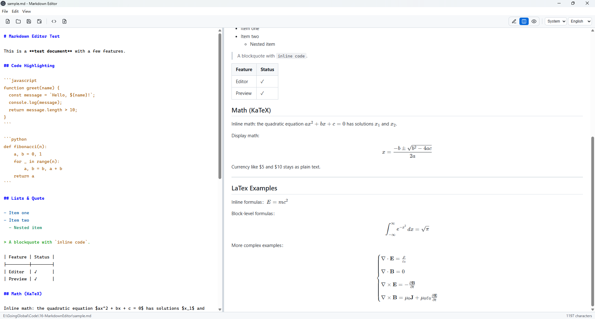
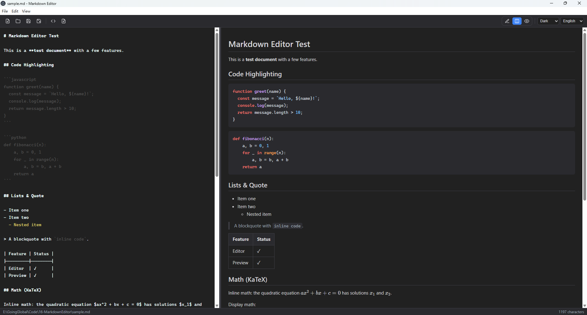
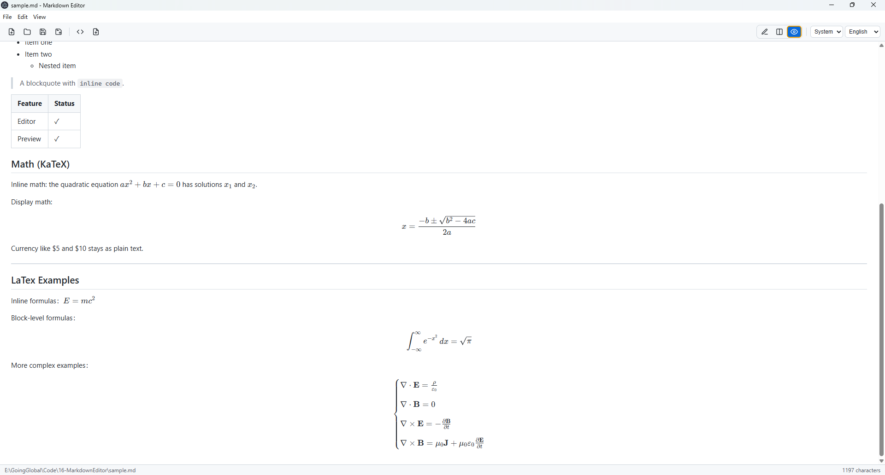
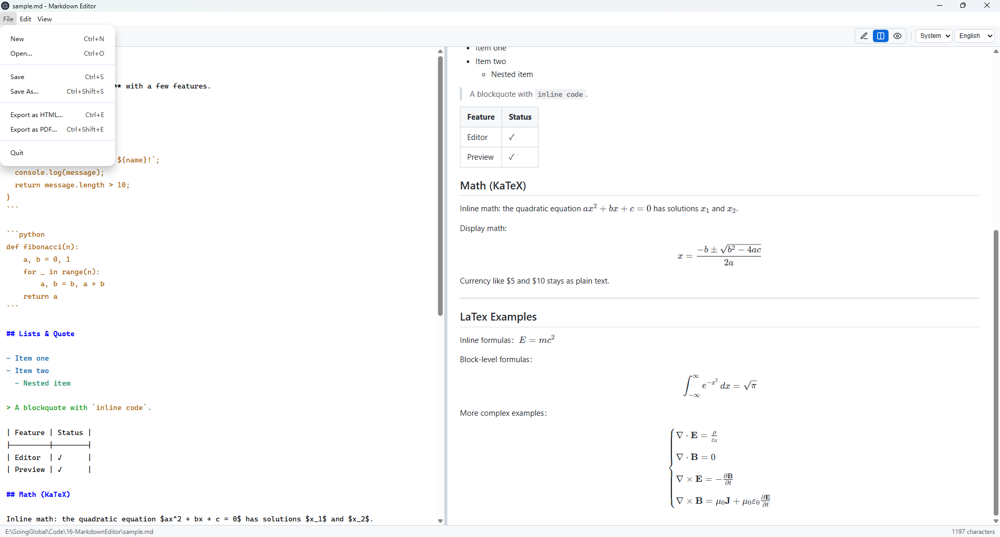

# Markdown Editor

简洁的跨平台（Windows / macOS）Markdown 编辑器，基于 Electron。

## 需求提示词

> 开发一个跨Windows和Mac平台的Markdown格式编辑器，支持编辑Markdown格式内容，Markdown格式文件预览，文件打开、保存等功能，md格式文件双击系统可以直接打开本软件打开对应的Markdown格式文件。界面简洁。
> 
> 需要增强功能：CodeMirror 替换 textarea 获得语法高亮、代码块高亮（highlight.js）、导出 HTML/PDF。工具栏的按钮改成直观的图标，增加国际化功能，软件默认英文，可以改成中文、日文、法文、韩文、德文、西班牙文、巴西葡萄牙文、俄文、意大利文，支持模式切换 System/Dark/Light

## 功能

- CodeMirror 编辑器：Markdown 语法高亮、列表自动续行、Tab 缩进
- 查找与替换：匹配计数、区分大小写、全字匹配、正则表达式、全部替换
- Markdown 格式栏：加粗、斜体、删除线、标题、引用、代码、链接和列表快捷操作
- 实时预览，代码块由 highlight.js 高亮（编辑 / 分屏 / 仅预览三种视图，Ctrl+1/2/3 切换）
- 安全预览：阻止原始 HTML 脚本和危险 URL，外部链接使用系统浏览器打开
- 文档大纲：自动提取标题并跳转到对应编辑位置
- 文件新建（Ctrl+N）、打开（Ctrl+O）、保存（Ctrl+S）、另存为（Ctrl+Shift+S）
- 多标签编辑、最近打开文件、启动时恢复上次标签页和未保存草稿
- 粘贴截图或拖入图片时自动保存到文档资源目录并插入相对路径
- 可选自动保存，以及覆盖文件前自动保留最近 20 个本地历史版本
- 原子保存：先安全写入同目录临时文件再替换，保存失败会明确提示且不破坏原文件
- 保留原始 UTF-8/UTF-16、BOM 和 CRLF/LF 换行格式
- 导出 HTML（Ctrl+E）/ 导出 PDF（Ctrl+Shift+E），导出内容含代码高亮样式
- 图标工具栏 + 状态栏（路径、字数、字符数、行数、光标行列和选区统计）
- 国际化：默认英文，可切换中文 / 日本語 / Français / 한국어 / Deutsch / Español / Português (Brasil) / Русский / Italiano（菜单、对话框、界面全部跟随，选择持久化）
- 主题：System（跟随系统）/ Light / Dark，编辑器与预览配色联动
- 系统中双击 .md / .markdown 文件直接用本软件打开（安装版生效）
- 未保存更改保护：退出前逐个提示保存，意外退出后恢复草稿
- 外部文件修改检测：提示加载磁盘最新内容或保留当前编辑内容
- 外部修改提供左右差异对比；文件被删除或移动时可重新定位、另存为、关闭或保留副本
- 编辑器设置：行号、自动换行、Tab 宽度、字号、默认视图和自动保存
- 转到行（Ctrl/Cmd+L）
- 单实例运行：再次双击文件复用已打开的窗口

## 开发运行

```bash
npm install
npm start
npm test
```

## 打包发布

```bash
npm run dist:win   # Windows，生成 NSIS 安装包（dist/ 目录）
npm run dist:mac   # macOS，生成 dmg（需在 Mac 上执行）
```

注意：

- **.md 双击关联只在"安装版"中生效**（`npm start` 开发模式不会注册文件关联）。
  关联由 `package.json` 中 `build.fileAssociations` 配置，electron-builder 打包时
  自动写入 Windows 注册表 / macOS Info.plist。
- macOS 的 dmg 需要在 Mac 上打包；未签名的应用首次打开需在"系统设置 → 隐私与安全性"中允许。

## 项目结构

```
main.js              主进程：窗口、国际化菜单、文件对话框、HTML/PDF 导出、文件关联、单实例
preload.js           contextBridge 安全桥接 + highlight.js 高亮服务
locales.js           十语言字典（主进程与渲染进程共用）
renderer/index.html  界面布局（图标工具栏、CodeMirror、主题/语言切换）
renderer/app.js      编辑器逻辑、实时预览（marked + hljs）、国际化、主题切换
renderer/style.css   应用样式（CSS 变量实现明暗主题）
renderer/export.css  导出 HTML/PDF 的独立样式
lib/file-utils.js     编码、换行检测与原子保存
lib/diff-utils.js     外部修改的逐行差异计算
test/                 Node 自动化测试
sample.md            测试文档
```

技术要点：

- 主题 System 模式通过 `matchMedia('(prefers-color-scheme: dark)')` 跟随系统并监听变化；
  深色时 CodeMirror 切换 material-darker 主题、预览切换 github-dark 高亮样式。
- 语言/主题选择存在 localStorage；切换语言时渲染进程通知主进程重建应用菜单。
- 撤销/重做/全选菜单项不用系统 role（会作用在 CodeMirror 的隐藏 textarea 上），
  改为转发给 CodeMirror 处理。
- PDF 导出：主进程把渲染好的 HTML 写入临时文件，用隐藏 BrowserWindow 加载后
  `printToPDF`（A4、含背景色）。
- preload 需要 `require('highlight.js')`，因此窗口关闭了 Electron 默认的 preload 沙箱
  （`sandbox: false`，仍保持 contextIsolation）。
  

## Screenshots








