# Markdown 与 Mermaid 预览示例

在 Markdown Editor 中打开此文件后，切换到**仅预览**或**分屏**。用大纲跳转到各个图型，切换浅色和深色主题观察配色。示例使用虚构的运营看板数据。

本文以 Markdown Editor 内置的 Mermaid 12.3 预览为准。GitHub 的 Mermaid 版本可能不同，实验图型和本地布局扩展可在应用中查看。 [GitHub Mermaid 版本说明](https://docs.github.com/en/get-started/writing-on-github/working-with-advanced-formatting/creating-diagrams#checking-your-version-of-mermaid)

## Markdown 基础

### 标题与段落

文档标题是一级标题，章节是二级标题，当前小节是三级标题。

#### 四级标题

##### 五级标题

###### 六级标题

这是第一段。段落之间以空行分隔。

这一行用反斜杠结束，产生硬换行。\
这一行和上一行仍然属于同一段。

### 行内格式

**加粗**、_斜体_、***加粗斜体***、~~删除线~~、`行内代码`、✅ Unicode 符号。

转义后显示原样的 \*星号\*、\[方括号\] 和 \`反引号\`。HTML 实体 &copy;、&amp; 和 &lt; 也可以在普通段落中使用。

### 列表与任务

- 指标入口
  - 网站 API
  - App API
- 汇总服务

1. 采集各来源的数据。
2. 清洗并按日期汇总。
   1. 按项目去重。
   2. 标记缺失记录。
3. 发布运营看板。

- [x] 核对数据来源
- [x] 验证本地预览
- [ ] 发布周报

### 引用与分隔线

> 每天早上九点刷新运营看板。
>
> > 遇到缺失数据时，显示最近一次成功汇总的时间。
>
> 运营看板示例约定

---

### 表格

| 指标 | 周期 | 样例值 |
| :--- | :---: | ---: |
| 网站访问 | 日 | 1,240 |
| App 会话 | 日 | 870 |
| 汇总状态 | 日 | **通过** |
| 管道标记 | 日 | A \| B |

### 链接与图片

[中文使用说明](../README_CN.md) · [Mermaid 语法文档][mermaid] · <https://mermaid.js.org/>

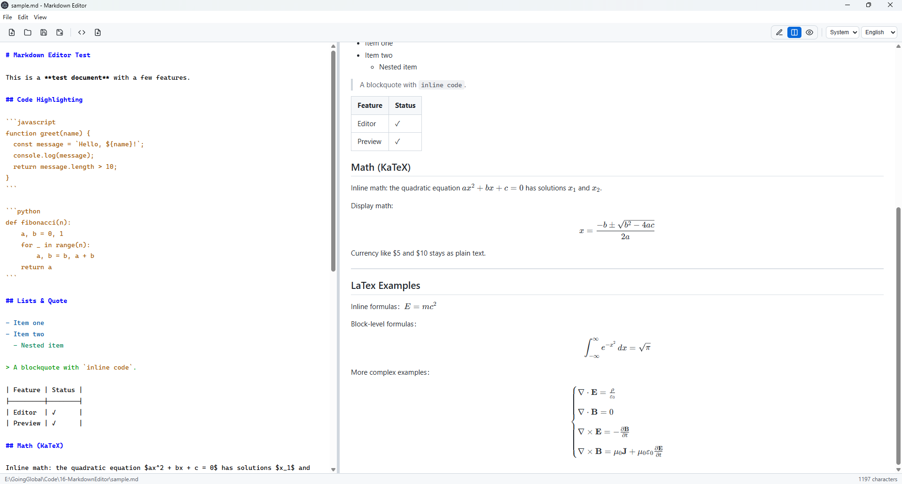

### 代码块

#### JavaScript

```javascript
const visits = [320, 410, 510];
const total = visits.reduce((sum, value) => sum + value, 0);
console.log(`总访问量：${total}`);
```

#### Bash 与 JavaScript here-document

```bash
node - <<'JS'
const counts = { website: 1240, app: 870 };
const total = counts.website + counts.app;
console.log(`TOTAL_SESSIONS=${total}`);
JS
printf '%s\n' '已汇总'
```

#### JSON

```json
{
  "period": "daily",
  "sources": ["website", "app"],
  "published": true
}
```

#### 普通文本

```text
website  →  1240
app      →   870
total    →  2110
```

### 数学公式

行内公式 $r = \frac{s}{n}$ 与正文一起排版。金额 $5 和 $10 是正文。

$$
\bar{x} = \frac{1}{n} \sum_{i=1}^{n} x_i
$$

$$
\begin{aligned}
  s &= 1240 + 870 \\
  r &= \frac{s}{2500} = 0.844
\end{aligned}
$$

### 原始 HTML

Markdown Editor 的安全预览会把原始 HTML 标签显示为文本。下面的标签可用于检查此行为。

<kbd>Ctrl</kbd> + <kbd>3</kbd>

## Mermaid 流程、样式与布局

### 指标采集流程图

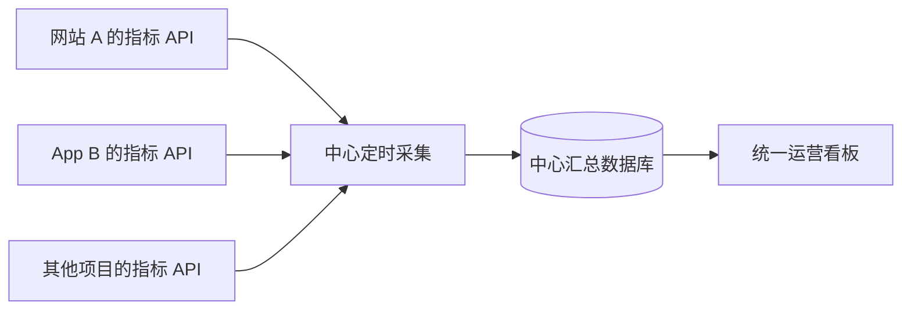

### 子图、条件分支和自定义节点样式

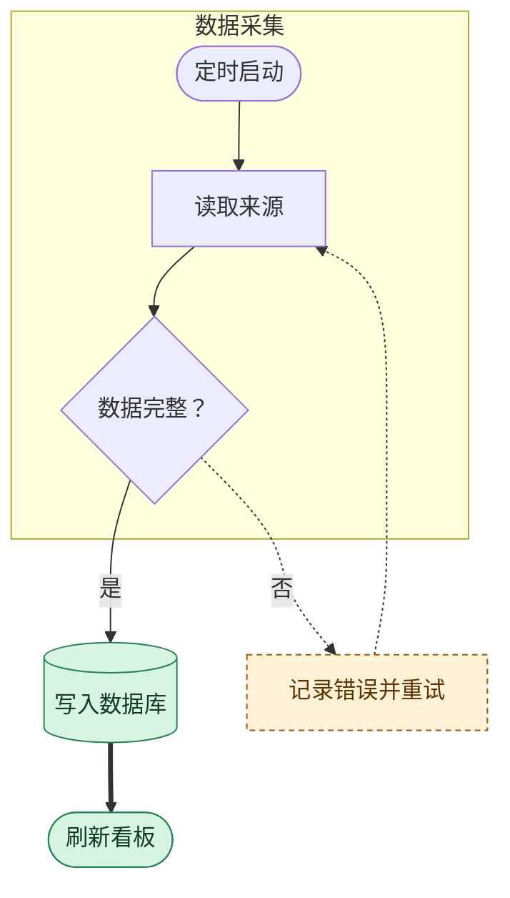

### 手绘外观与 ELK 布局

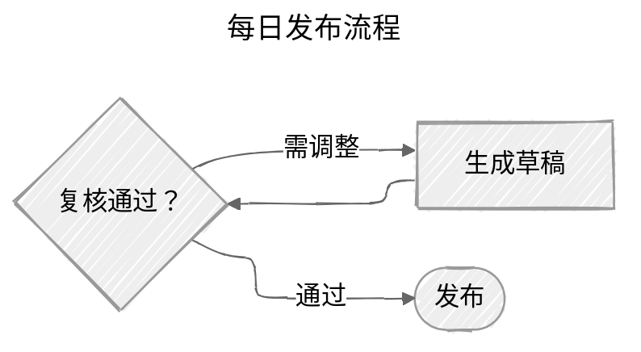

### 深色主题与 Dagre 布局

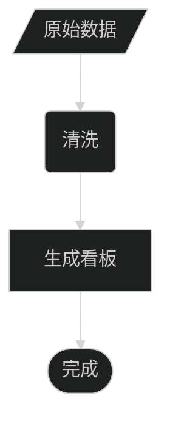

### 思维导图节点与图标

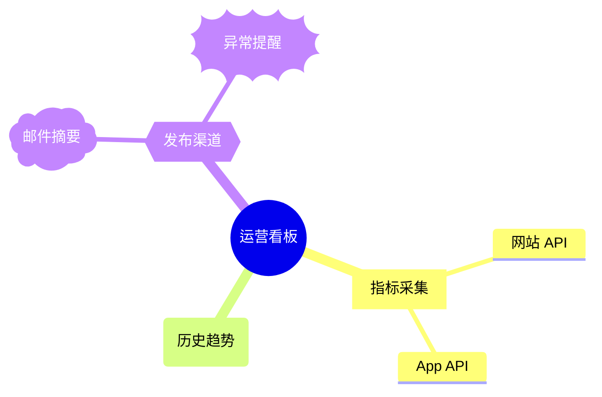

### Tidy Tree 思维导图

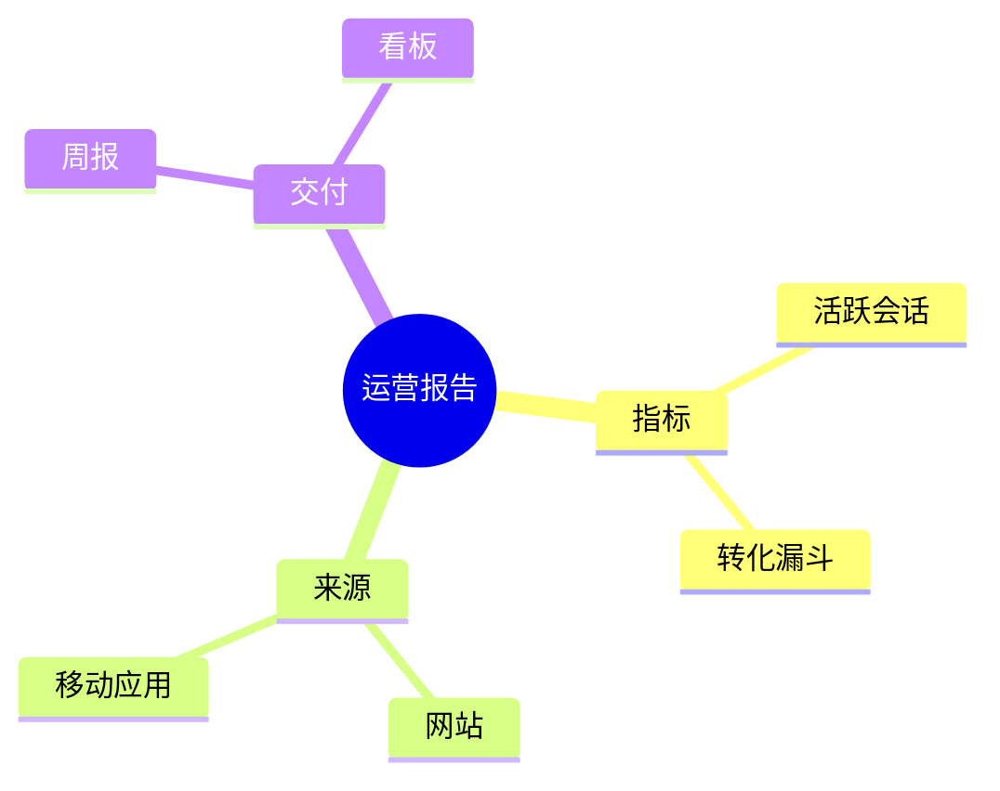

### 基础泳道图

```mermaid
swimlane-beta LR
    subgraph source [数据来源]
        raw[生成指标]
        send[推送数据]
    end
    subgraph platform [运营平台]
        check[校验数据]
        dashboard[更新看板]
    end
    raw --> send
    send --> check
    check --> dashboard
```

## Mermaid 软件与系统建模

### 时序图

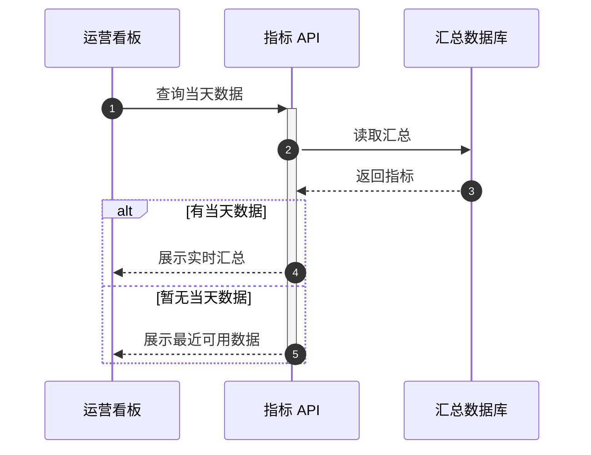

### 类图

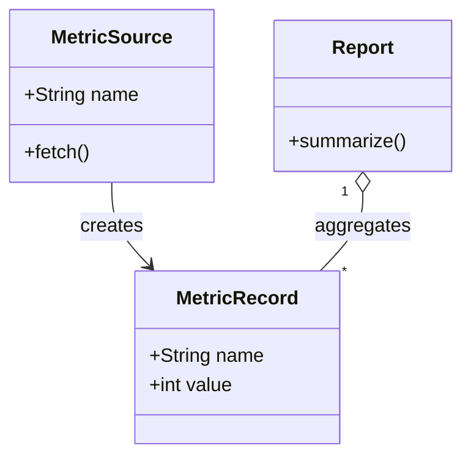

### 状态图

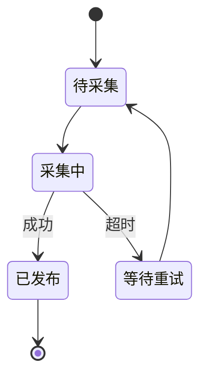

### 实体关系图

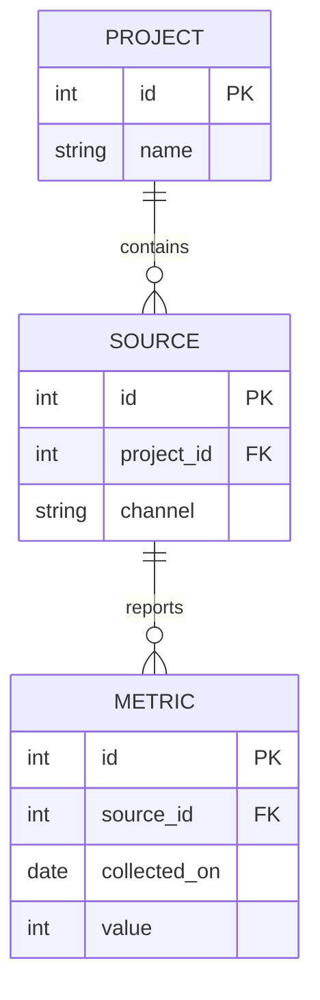

### 用例图

```mermaid
usecase-beta
    actor Analyst("运营人员")
    actor Maintainer("维护人员")
    systemBoundary "运营看板"
        View("查看汇总")
        Export("导出周报")
        Configure("维护来源")
    end
    Analyst --> View
    Analyst --> Export
    Maintainer --> Configure
```

### 需求图

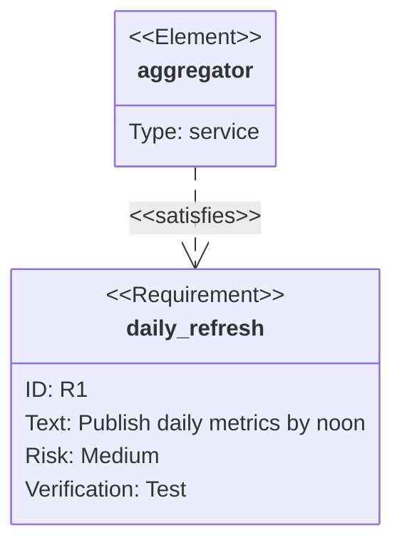

### 架构图


### C4 系统上下文图

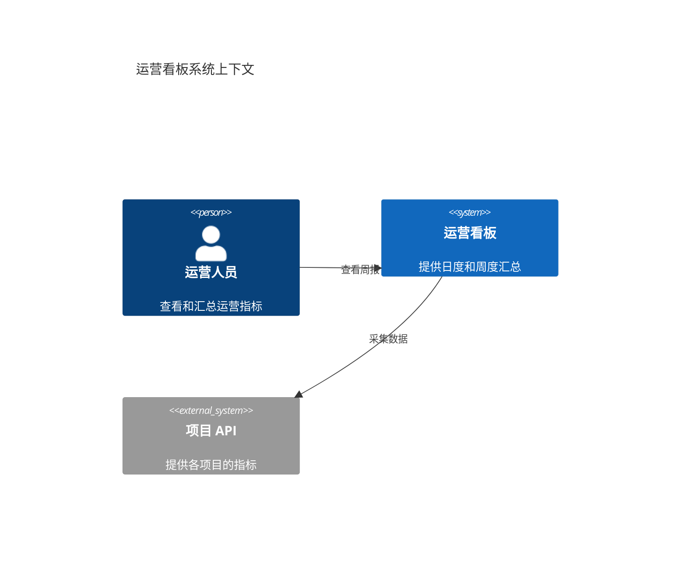

### C4 容器图

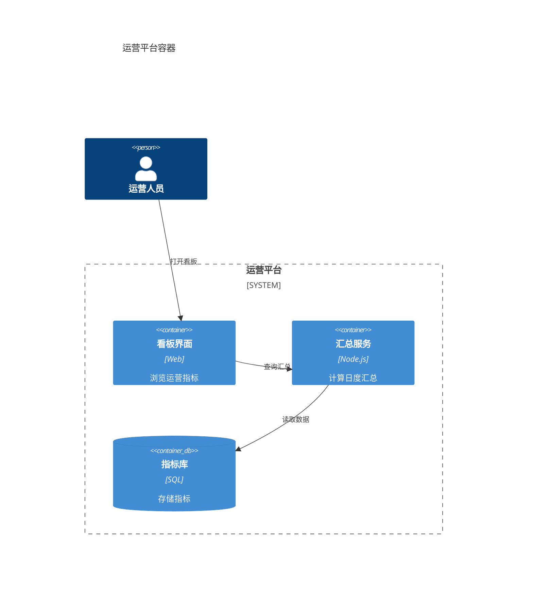

### 方块图

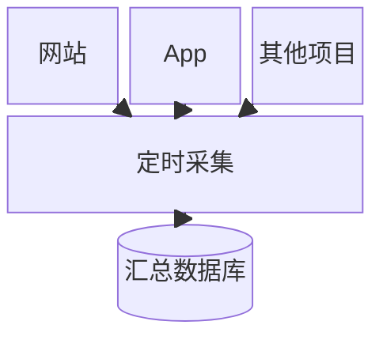

### 数据包结构

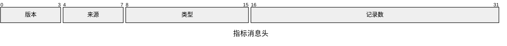

### 事件建模

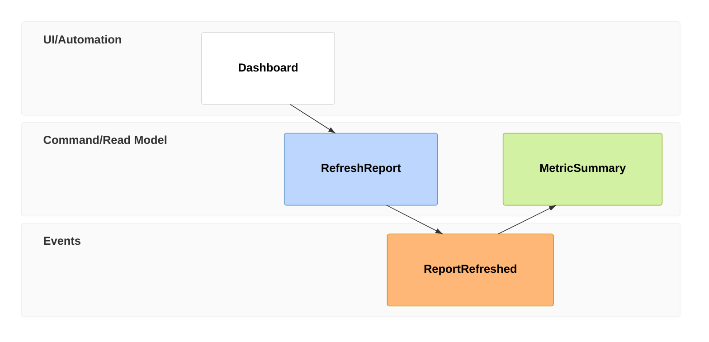

### Agentflow

```mermaid
agentflow-beta TB
    flow report["整理周报"]
        read["读取汇总"]@{ instruction: "读取本周已经汇总的指标。" }
        draft["生成摘要"]@{ instruction: "按来源整理变化最大的三项指标。" }
        read --> draft
    end
```

## Mermaid 进度与活动

### 甘特图

```mermaid
gantt
    title 运营看板迭代
    dateFormat YYYY-MM-DD
    axisFormat %m-%d
    section 数据
    确认指标       :done, spec, 2026-11-02, 2d
    接入数据来源   :active, source, after spec, 4d
    section 发布
    预览校验       :check, after source, 2d
    上线演示       :milestone, launch, after check, 0d
```

### 时间线

```mermaid
timeline
    title 运营看板演进
    2024 : 收集网站指标
    2025 : 加入 App 会话 : 统一采集周期
    2026 : 发布跨项目看板
```

### 看板与工单链接

```mermaid
---
config:
  kanban:
    ticketBaseUrl: 'https://example.com/issues/#TICKET#'
---
kanban
    todo[待处理]
      checklist[补充数据来源清单]@{ ticket: 41, priority: 'Low' }
    doing[进行中]
      chart[校验运营图表]@{ ticket: 42, assigned: 'Team', priority: 'High' }
    done[已完成]
      collector[建立每日采集任务]
```

### 用户旅程

```mermaid
journey
    title 查看每日指标
    section 查找
      打开运营看板: 5: 运营人员
      选择日期: 4: 运营人员
    section 核对
      确认各项目汇总: 4: 运营人员, 数据团队
      记录缺失来源: 3: 数据团队
```

### Git 分支图

```mermaid
gitGraph
    commit id: "initial"
    branch preview
    checkout preview
    commit id: "add-diagrams"
    commit id: "verify-samples"
    checkout main
    merge preview tag: "demo-ready"
```

## Mermaid 数据可视化

### 饼图

```mermaid
pie showData title 会话来源
    "网站" : 1240
    "App" : 870
    "其他" : 390
```

### XY 柱线组合图

```mermaid
xychart-beta
    title "每周会话"
    x-axis ["周一", "周二", "周三", "周四", "周五"]
    y-axis "会话数" 0 --> 300
    bar [120, 165, 180, 205, 250]
    line [130, 155, 175, 200, 230]
```

### 桑基图

```mermaid
sankey-beta

Website,Collector,1240
App,Collector,870
Collector,Published,1950
Collector,Quality review,160
```

### 四象限图

```mermaid
quadrantChart
    title 任务优先级
    x-axis 低投入 --> 高投入
    y-axis 低收益 --> 高收益
    quadrant-1 规划投入
    quadrant-2 优先实施
    quadrant-3 随手处理
    quadrant-4 重新评估
    图表校验: [0.24, 0.83]
    来源接入: [0.75, 0.72]
    名称清理: [0.20, 0.30]
    历史迁移: [0.73, 0.46]
```

### 雷达图

```mermaid
radar-beta
    title "数据质量评分"
    axis c["完整性"], t["时效"], a["准确性"], r["可追溯性"], s["稳定性"]
    curve site["网站"]{92, 85, 91, 72, 88}
    curve app["App"]{86, 92, 88, 84, 76}
    min 0
    max 100
```

### 矩形树图

```mermaid
treemap-beta
    "网站"
        "自然流量": 760
        "直接访问": 480
    "App"
        "iOS": 520
        "Android": 350
```

### 韦恩图

```mermaid
venn-beta
    title "访问渠道覆盖"
    set Web["网站"]: 65
    set App["App"]: 50
    union Web,App["双渠道"]: 25
```

## Mermaid 分析与结构

### 鱼骨图

```mermaid
ishikawa-beta
    数据汇总延迟
    来源
        接口超时
        返回格式更新
    采集
        错过定时任务
        重试间隔过长
    校验
        缺少字段
        数据重复
```

### 目录树

```mermaid
treeView-beta
    dashboard/
        docs/
            overview.md
            preview-showcase.md
        data/
            website.json
            app.json
        README.md
```

### Wardley 地图

```mermaid
wardley-beta
title Reporting Platform
size [820, 480]

anchor Operations Team [0.95, 0.50]
component Dashboard [0.80, 0.65]
component Aggregation [0.57, 0.48]
component Database [0.29, 0.86]

Operations Team -> Dashboard
Dashboard -> Aggregation
Aggregation -> Database
```

### Cynefin 框架

```mermaid
cynefin-beta
    title 数据问题分类
    complex
        "分析用户行为变化"
    complicated
        "定位跨项目汇总错误"
    clear
        "补录缺失的来源名称"
    chaotic
        "处理采集服务中断"
```

### 铁路图

```mermaid
railroad-beta
    title 指标键名
    key = sequence(nonterminal("source"), terminal("."), nonterminal("metric"));
```

### EBNF 铁路图

```mermaid
railroad-ebnf-beta
    title 点分指标路径
    path = name, { ".", name };
    name = "website" | "app" | "sessions";
```

### ABNF 铁路图

```mermaid
railroad-abnf-beta
    title 指标编号
    metric-id = "M-" 1*DIGIT ;
```

### PEG 铁路图

```mermaid
railroad-peg-beta
    title 指标来源
    Source <- "website" / "app" ;
```

### 渲染器版本

```mermaid
info
```

[mermaid]: https://mermaid.js.org/intro/syntax-reference
